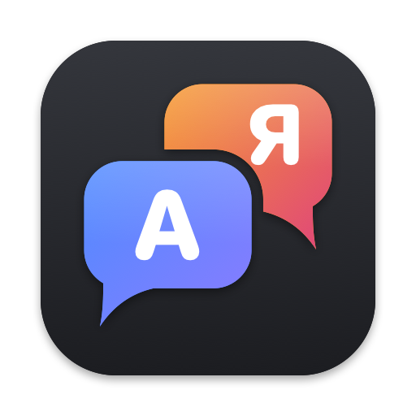

<p align="center">
  
</p>

<h1 align="center">Translate Desktop — Google Translate app for Mac with dark mode</h1>

<p align="center">
  The full translate.google.com website in its own lightweight Mac window.<br>
  Unofficial, not affiliated with Google.
</p>

<p align="center">
  <a href="../../releases/latest"></a>
  
  
</p>

---

## Features

- 🌙 **Dark mode** — Google Translate's own dark theme, following the macOS appearance. Or pick Light / Dark in
  the **Appearance** menu.
- 👤 **Your Google account** — sign in once, the session is kept: history and saved translations included.
- 📄 **Text, images and documents** — choose files to translate, translated documents go to Downloads;
  voice input asks macOS for the microphone the first time.
- 🔗 **Links to other sites** open in your default browser.
- 🔄 **Automatic updates** — new versions are downloaded from GitHub Releases and checked against a
  cryptographic signature before installing. Or choose **Translate Desktop ▸ Check for Updates…**
- 🌐 **Your language** — the app follows the macOS language (English and Russian).
- 🪶 **Native and light** — about 2 MB, Swift, AppKit and WebKit. No Electron, no tracking, no API keys.

## Download and install

1. Download **TranslateDesktop.zip** from the [latest release](../../releases/latest) and unzip it.
2. Move **Translate Desktop.app** to your **Applications** folder.
3. Open it. The first time, macOS warns that the developer can't be verified (Translate Desktop isn't
   notarized by Apple): open **System Settings ▸ Privacy & Security** and click **Open Anyway**. Or run once:
   ```bash
   xattr -dr com.apple.quarantine "/Applications/Translate Desktop.app"
   ```

## Build from source

Only the Command Line Tools are needed (`xcode-select --install`):

```bash
./build.sh            # → build/Translate Desktop.app
./build.sh --install  # and copy it to ~/Applications
```

`VERSION`, `BUILD` and `SIGN_ID` (signing certificate name) can be set in the environment; without a
certificate the app is signed ad hoc. Builds with version 0.0.0 don't check for updates on their own.

## License

MIT. Google Translate is a trademark of Google LLC; this project is not affiliated with Google.
